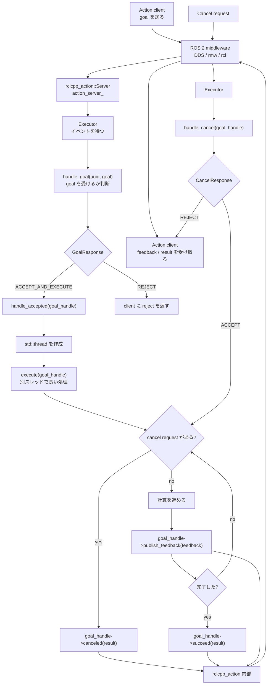

# ROS 2 Executor / Action Server Flow

この図は `fibonacci_action_server.cpp` のような ROS 2 action server で、executor、callback、別スレッド、`goal_handle` がどう関係するかを表したものです。

## 役割の対応

| 要素                | 役割                                                                     |
| ------------------- | ------------------------------------------------------------------------ |
| `action_server_`    | action server オブジェクトを Node の寿命中保持する                       |
| `executor`          | goal、cancel、timer、subscription などのイベントを待って callback を呼ぶ |
| `handle_goal`       | goal を受けるか拒否するか決める                                          |
| `handle_accepted`   | goal を受理したあと、重い処理を別スレッドへ渡す                          |
| `execute`           | 実際の長い処理を進める                                                   |
| `goal_handle`       | その goal に対して feedback、success、cancel 結果を返すためのハンドル    |
| `rcl` / `rmw` / DDS | 実際の ROS 2 通信を担当する下位層                                        |

## 感覚的な理解

Web フレームワーク風に見ると、だいたい次の対応になる。

| Web 側の感覚        | ROS 2 側                                      |
| ------------------- | --------------------------------------------- |
| request             | topic message / service request / action goal |
| router / event loop | executor                                      |
| handler             | callback                                      |
| response writer     | `goal_handle`                                 |
| background job      | action の `execute`                           |

つまり、ユーザーコードは「イベントが来たら呼ばれる callback」を登録し、executor と ROS 2 の内部がそれを必要なタイミングで呼び出す。
